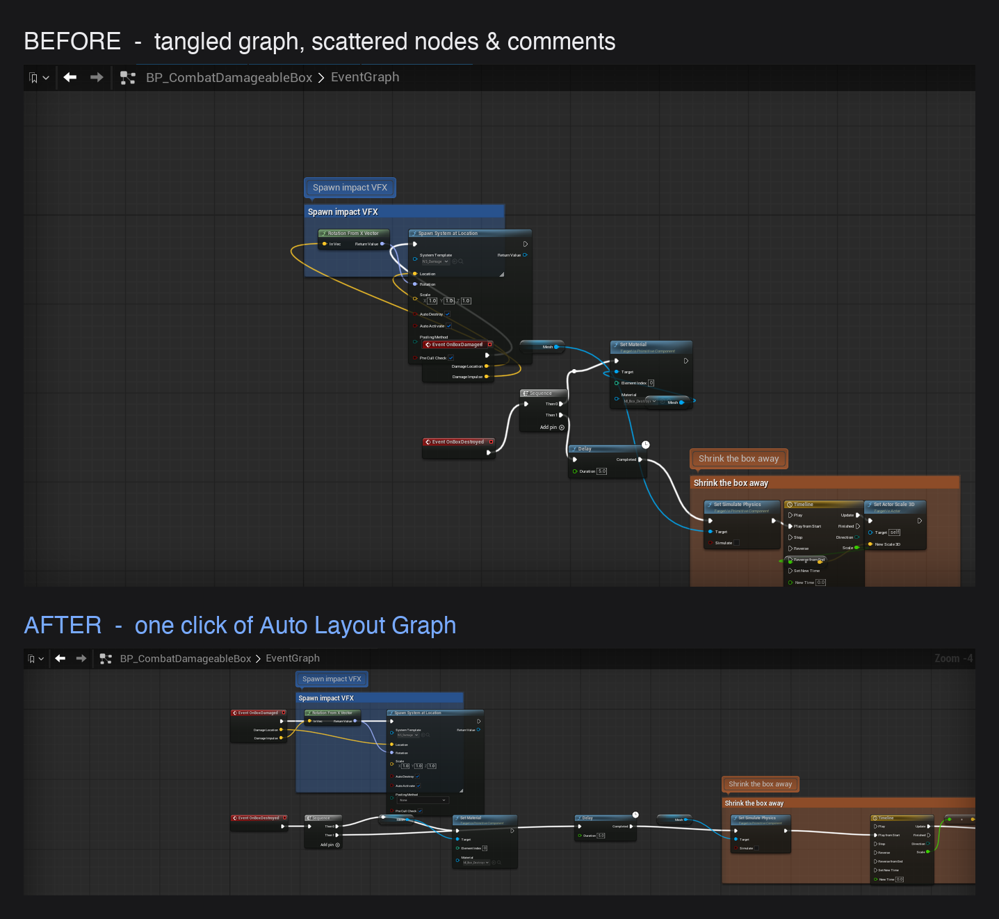
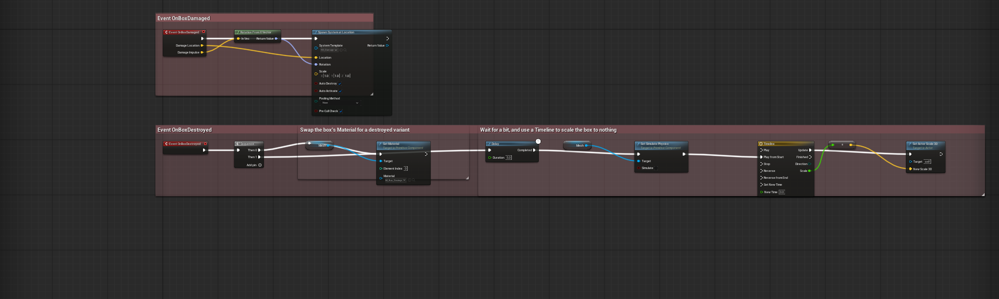

# Blueprint Anti-Pasta — Documentation

Pin-aware auto-layout for Unreal Engine Blueprint graphs. One keyboard shortcut, one toolbar click, or a right-click menu action rearranges tangled nodes into a readable left-to-right flow, and one `Ctrl+Z` undoes the whole thing.

Online copy of this page: https://github.com/ibrews/blueprint-auto-layout/blob/main/Docs/Documentation.md
Support: https://github.com/ibrews/blueprint-auto-layout/issues



## 1. Requirements

- Unreal Engine 5.4, 5.5, 5.6, 5.7 or 5.8 (use the download that matches your engine version; Windows 64-bit, plus macOS for 5.7 and 5.8).
- The plugin ships as **source code**, so your machine needs the C++ toolchain for your platform. Windows: Visual Studio with the "Game development with C++" workload. macOS: Xcode.
- Works in Blueprint and Animation Blueprint graphs (event graphs, functions, macros). Material, Niagara and Behavior Tree graphs are not handled.

## 2. Install

Pick **one** of these.

### Option A: install into a single project (simplest)

1. Download the plugin from Fab (or from your Fab library in the Epic Games Launcher) and unzip it if needed. You should have a folder named `BlueprintAutoLayout` containing `BlueprintAutoLayout.uplugin`.
2. Close the editor. Copy the `BlueprintAutoLayout` folder into `<YourProject>/Plugins/`. Create the `Plugins` folder if it does not exist.
3. Right-click your `.uproject` file and choose **Generate Project Files** (on macOS: **Services → Generate Xcode Project**).
4. Open the project. When the editor says the plugin module is missing or out of date, choose **Yes** to rebuild. This is the plugin compiling for the first time and takes a minute or two.
5. Open **Edit → Plugins**, search for "Blueprint Anti-Pasta", and make sure it is ticked. Restart the editor if it asks you to. (It is enabled by default.)

If the build fails, build the project from your IDE (open the generated `.sln` or Xcode project and build the editor target) and read the error output there.

### Option B: build a portable copy for several projects

Use Unreal's own packaging command, then drop the output where your engine can see it.

```bat
:: Windows
"<EngineInstallDir>\Engine\Build\BatchFiles\RunUAT.bat" BuildPlugin ^
  -Plugin="<path>\BlueprintAutoLayout\BlueprintAutoLayout.uplugin" ^
  -Package="<output-dir>\BlueprintAutoLayout" ^
  -Rocket
```

```sh
# macOS
"<EngineInstallDir>/Engine/Build/BatchFiles/RunUAT.sh" BuildPlugin \
  -Plugin="<path>/BlueprintAutoLayout/BlueprintAutoLayout.uplugin" \
  -Package="<output-dir>/BlueprintAutoLayout" \
  -Rocket
```

Copy the `-Package` output folder into `<EngineInstallDir>/Engine/Plugins/Marketplace/` (available to every project on that engine) or into a project's `Plugins/` folder, then enable it in **Edit → Plugins** if it is not already on.

## 3. Quick start (60 seconds)

1. Open any Blueprint with a few nodes, or make a throwaway one with a `Branch`, two `Print String` nodes and a `Sequence`.
2. Press **Ctrl+A** to select all, and drag the nodes into a random pile.
3. Press **Ctrl+Shift+L** (macOS: **Cmd+Shift+L**).
4. The nodes snap into a clean left-to-right flow. Press **Ctrl+Z** once and the entire layout reverts.

## 4. How to use it

Open any Blueprint, Animation Blueprint or macro graph. There are three ways to run an action:

| Way | How |
|---|---|
| Keyboard | **Ctrl/Cmd+Shift+L** lays out the whole graph. **Ctrl/Cmd+Shift+K** lays out only the selected nodes. |
| Toolbar | Click the **Auto Layout** button in the Blueprint editor toolbar to run the last-used action. Click its dropdown arrow to choose any action. |
| Right-click | Right-click empty graph space (not a node or pin) and pick an action from the **Layout** section. |

### The five actions

| Action | What it does |
|---|---|
| **Auto Layout Graph** | Arranges the whole graph. This is the default action. |
| **Auto Layout Selected** | Arranges only the selected nodes, in place. Greyed out when nothing is selected. |
| **Auto Layout & Group Graph** | Arranges the graph, then wraps each event or function in a comment box named after it and colored by keyword. |
| **Auto Layout (Route Wires)** | Arranges the graph, then bends any wire that still crosses a node around it using reroute (knot) nodes. |
| **Auto Layout, Group & Route** | Does both of the above. |

Choosing an action from the toolbar dropdown makes it the button's new default, and the choice is remembered between editor sessions.

Every action is a single undo step. The plain layout actions never delete your nodes. The grouping and routing actions only add comment boxes and reroute nodes. Reroute nodes added by the plugin are tagged, so running the action again replaces them instead of piling up more.

### Comment box colors

Group comment boxes are colored by keywords in the root node's title: `Damage`/`Hit` red, `Destroy`/`Death` dark red, `Spawn`/`Create` green, `Begin`/`Init` blue, `Tick`/`Update` teal, `Input`/`Pressed` amber, `Overlap`/`Collision` violet. Titles with no keyword get a stable color derived from the name.



## 5. Settings

**Editor Preferences → Plugins → Blueprint Anti-Pasta**

| Setting | Default | What it does |
|---|---|---|
| Use layered (Sugiyama) engine | On | The main layout engine. Turn off to use the older single-parent tree layout. |
| Knot-route long edges | On | Rewires wires that span several columns through reroute knots so they draw as straight segments. Turn off to leave them as plain curved wires. |
| Wire handling | Straighten & move nodes | **Straighten & move nodes** keeps wires straight by moving nodes. **Reroute with knots** keeps nodes in place and bends wires around obstacles. **Off** lays out nodes without touching wire shape. The Route Wires actions always insert knots regardless of this setting. |
| Pin-align tolerance | 120 | Maximum distance a node may be nudged vertically to line a pin up into a straight wire. Lower keeps nodes closer to their natural position. Higher straightens more wires. |
| Comment color mode | Keyword (semantic) | **Keyword** colors group boxes by title keyword. **Cycling palette** steps through a fixed palette. |
| Spacing | — | Horizontal, vertical, branch/lane and event spacing in graph units. Raise for airier graphs, lower for denser ones. |

### Changing the keyboard shortcuts

Open **Editor Preferences → Keyboard Shortcuts**, find **Blueprint Anti-Pasta**, and rebind either shortcut.

## 6. Troubleshooting

| Problem | Fix |
|---|---|
| "Plugin missing or built with a different engine version" on launch | Click **Yes** to rebuild. If you are on a different engine version than the download you used, get the download that matches your engine. |
| Build fails on first launch | Install the C++ toolchain (see Requirements), regenerate project files, and build from your IDE to see the full error. |
| No **Auto Layout** button or **Layout** menu | Check **Edit → Plugins** that Blueprint Anti-Pasta is enabled, restart the editor, and reopen the Blueprint. |
| Shortcut does nothing | The shortcut only works while a Blueprint graph has focus. Click on empty graph space first. Check **Editor Preferences → Keyboard Shortcuts** for a conflicting binding. |
| **Auto Layout Selected** is greyed out | Select at least one node first. |
| A wire still has a slight bend after layout | On complex multi-pin nodes (for example a Timeline), pin positions for knot lanes are estimated, so a gentle bend can remain. Try the **Route Wires** actions, or the "Reroute with knots" wire handling. |
| Nothing happens on a Material or Niagara graph | Not supported. Blueprint and Animation Blueprint graphs only. |

## 7. Uninstall

Close the editor, delete the `BlueprintAutoLayout` folder from `<YourProject>/Plugins/` (or from `Engine/Plugins/Marketplace/`), and reopen the project. Your Blueprints are not modified by removing the plugin, and any reroute nodes or comment boxes it added are ordinary graph nodes that stay in your graphs.

## 8. Support

Questions, bugs and feature requests: https://github.com/ibrews/blueprint-auto-layout/issues
